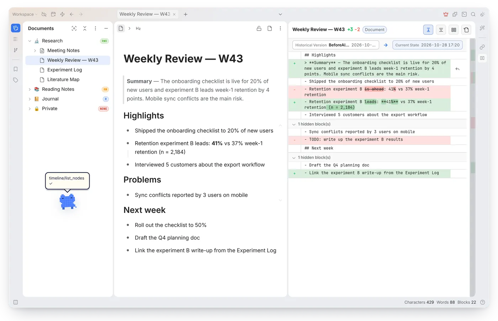
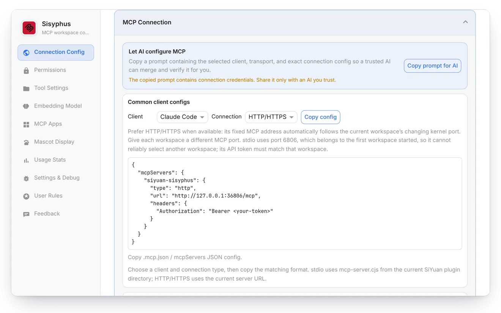
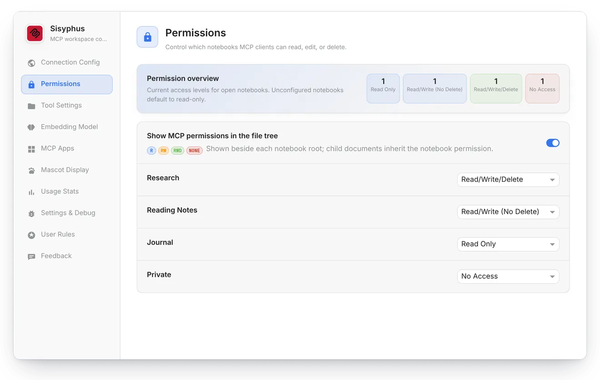
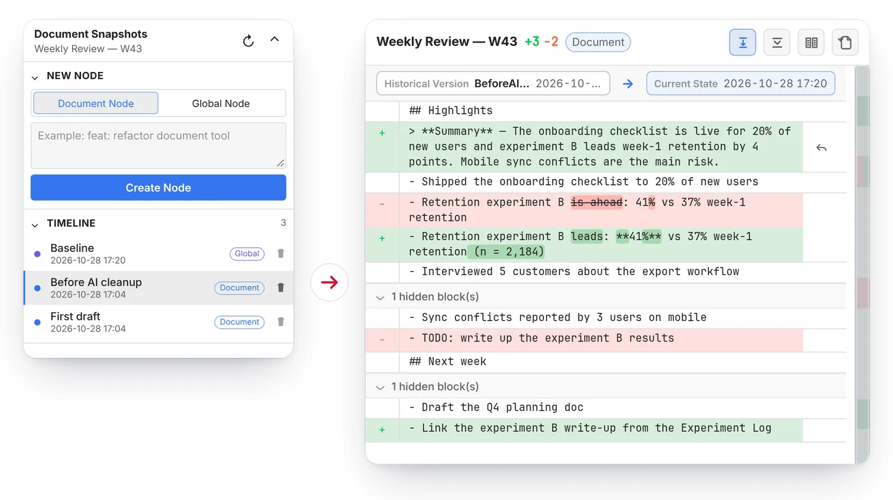
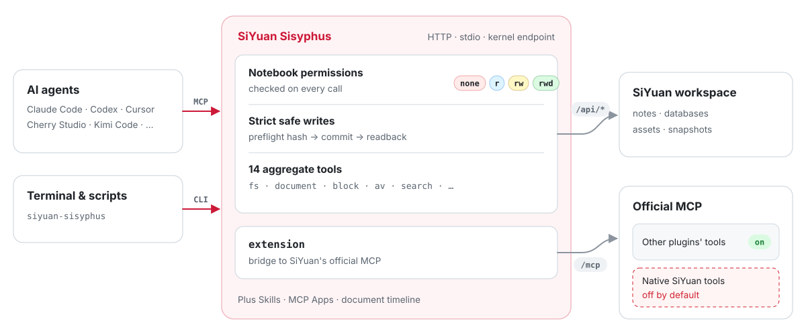

<p align="center">
  
</p>

<h1 align="center">SiYuan Sisyphus</h1>

<p align="center">
  <strong>Let AI agents work in your SiYuan notes, only where you allow and with every change reviewable.</strong>
</p>

<p align="center">
  An MCP server and CLI for SiYuan: 14 aggregate tools, notebook-level permissions,<br>
  strict safe writes, a Git-like document timeline and interactive MCP Apps.
</p>

<p align="center">
  <a href="https://github.com/yangtaihong59/siyuan-plugins-mcp-sisyphus/releases"></a>
  <a href="https://www.npmjs.com/package/siyuan-sisyphus"></a>
  <a href="https://yangtaihong59.github.io/siyuan-plugins-mcp-sisyphus/"></a>
  <a href="https://github.com/yangtaihong59/siyuan-plugins-mcp-sisyphus/blob/main/LICENSE"></a>
</p>

<p align="center">
  <strong>English</strong> ·
  <a href="https://github.com/yangtaihong59/siyuan-plugins-mcp-sisyphus/blob/main/README_zh_CN.md">简体中文</a> ·
  <a href="https://yangtaihong59.github.io/siyuan-plugins-mcp-sisyphus/">Documentation</a> ·
  <a href="https://github.com/yangtaihong59/siyuan-plugins-mcp-sisyphus/blob/main/CHANGELOG.md">Changelog</a>
</p>

<p align="center">
  
</p>
<p align="center"><sub>An agent has just tidied up a weekly review. The file tree shows what it may touch, the Document Diff dock shows what it changed, and the mascot reports the last tool call.</sub></p>

> **Latest: v0.6.13.** Clients without form-confirmation support no longer hit elicitation errors, while permissions and safe-write preflight still apply. The MCP settings page now also generates DSH Cordis YAML. See the [changelog](https://github.com/yangtaihong59/siyuan-plugins-mcp-sisyphus/blob/main/CHANGELOG.md) for earlier releases.

## Highlights

- **Notebook-level permissions.** Every notebook is `none`, `r`, `rw` or `rwd`, and risky actions such as delete, move and replace have their own switches.
- **Strict safe writes.** A write is checked against the target's current-state hash, committed once and read back. Nothing is retried blindly.
- **A document timeline for AI edits.** Take a node before the agent starts, compare it with the current document, and roll back the whole document or a single block.
- **Small context, broad coverage.** More than 100 SiYuan capabilities sit behind 14 action-routed tools. Detailed help and Skills load only when needed.
- **Human-readable paths.** `fs` works with paths like `/Notebook/Project/Note`, so agents do not need to know block IDs or the document tree.
- **MCP Apps.** Flashcard review, the document timeline and the mascot shop open inside the conversation, and the user makes the final click.
- **The official MCP ecosystem.** `extension` bridges SiYuan's official `/mcp`, so tools registered by other plugins appear in the same session.
- **MCP and CLI share one core.** A tool behaves the same whether an agent calls it over MCP or a script runs it from the terminal.

## Quick start

1. Install **SiYuan Sisyphus** from the SiYuan marketplace. The plugin runs on SiYuan 2.9.0+; the official MCP bridge and the kernel endpoint need SiYuan 3.7.0+.
2. Open the plugin settings, go to **Connection Config → MCP Connection**, pick your client and transport, then copy the generated config. Presets cover Claude Code, Codex CLI, Cursor, Cherry Studio, Kimi Code, OpenCode, CC Switch and DSH.
3. Start with a read-only request such as *"List my SiYuan notebooks"*.

<p align="center">
  
</p>

Prefer the terminal? The CLI runs the same tools directly and keeps their schemas out of the model's context:

```bash
npm i -g siyuan-sisyphus
siyuan-sisyphus init                       # SiYuan API URL and token
siyuan-sisyphus notebook list
siyuan-sisyphus document list-tree --notebook <id> --json
```

Local, remote, Docker, HTTPS and mobile setups are covered in [Getting Started](https://yangtaihong59.github.io/siyuan-plugins-mcp-sisyphus/getting-started/) and [Deployment](https://yangtaihong59.github.io/siyuan-plugins-mcp-sisyphus/getting-started/deployment.html).

## You stay in control

### Notebook permissions

| Level | Read | Write | Delete |
|---|:---:|:---:|:---:|
| `rwd` | ✓ | ✓ | ✓ |
| `rw` | ✓ | ✓ | |
| `r` | ✓ | | |
| `none` | | | |

Documents inherit their notebook's level. Notebooks without an entry are read-only, and notebooks created after installation start at `rwd`. The badge beside each notebook in the file tree shows its level; click it to cycle through the levels.

<p align="center">
  
</p>

### Strict safe writes

Strict safe writes are on by default (**Settings & Debug → Strict safe writes**).

- A mutation first runs with `validateOnly=true` to get the target's current-state hash. The commit then carries the server-issued `requestId` and the matching `expected*Hash`.
- A write is sent once. A timeout or a dropped connection returns `outcome_unknown` instead of risking a duplicate, and a committed `requestId` replays from the ledger.
- No SiYuan data snapshots are created. Side effects that cannot be read back, such as sync, exports, notifications and third-party tools, are marked as not strictly guaranteed.
- The CLI and stdio forward strict writes to a single coordinator: the plugin's HTTP server, or the kernel endpoint when it is enabled (the option for Docker and browser setups).

Dangerous actions such as deletes, moves, replacements and asset uploads need explicit confirmation. Clients that support MCP elicitation confirm them in a form before anything is sent; other clients keep the `confirm=true` convention. See [Strict Safe Writes](https://yangtaihong59.github.io/siyuan-plugins-mcp-sisyphus/reference/write-safety.html) and [Permissions](https://yangtaihong59.github.io/siyuan-plugins-mcp-sisyphus/reference/permissions.html).

## Review and roll back with the document timeline

<p align="center">
  
</p>

- Create a **document node** before handing a document to an agent, or a **global node** that every document can see.
- Select a node to open **Document Diff**, with unified and split views, word-level highlights, folded unchanged blocks and a change minimap.
- Roll back the whole document or restore a single block.
- Deleting a node removes only its protective tag. The underlying SiYuan snapshot stays.

Agents get the same workflow through the [`timeline` tool](https://yangtaihong59.github.io/siyuan-plugins-mcp-sisyphus/reference/tools/timeline.html). Deleting nodes and rolling back are high-risk and disabled for AI by default. The timeline is built on SiYuan's workspace snapshots, so it is a safety net rather than a full Git replacement.

## MCP Apps in the conversation

Clients that negotiate `io.modelcontextprotocol/ui` get three launcher tools, each opening an inline App.

<p align="center">
  
</p>

| App | Launcher | What happens |
|---|---|---|
| [Flashcard review](https://yangtaihong59.github.io/siyuan-plugins-mcp-sisyphus/reference/tools/flashcard.html) | `flashcard_review_session` | The agent picks 1–20 due cards. You reveal each answer and rate it Again, Hard, Good or Easy. |
| [Document timeline](https://yangtaihong59.github.io/siyuan-plugins-mcp-sisyphus/reference/tools/timeline.html) | `timeline_app` | Browse and create nodes, inspect the block diff, and restore the document or one block. |
| [Mascot shop](https://yangtaihong59.github.io/siyuan-plugins-mcp-sisyphus/reference/tools/mascot.html) | `mascot_shop_app` | Spend the coins the mascot earns from tool calls. Picking up an item feeds the desktop mascot. |

- Only the launcher opens an App. Ordinary `flashcard`, `timeline` and `mascot` calls remain data tools.
- The agent prepares the round and you make the decisions. The model never answers cards, picks ratings, rolls back notes or buys items for you.
- App actions are hidden from the model with `visibility: ["app"]` and are enabled one by one under **Settings → MCP Apps**.
- Clients without MCP Apps support see none of this. Aggregate tools and the CLI work as before.

## Works with SiYuan's official MCP

On SiYuan 3.7.0+, `extension` reads the official `/mcp` registry and turns each allowed tool into an action. Downstream arguments stay inside `arguments`, so a tool's own `action` field never collides with Sisyphus routing:

```json
{ "action": "plugin__example__search", "arguments": { "action": "query", "keyword": "MCP" } }
```

| Tool source | Default | Security boundary |
|---|---|---|
| Sisyphus aggregate tools | On | Notebook permissions, action switches and strict safe writes |
| Tools registered by other plugins | On | Discovered by `extension`; each tool keeps its own permission semantics |
| Native SiYuan MCP tools | Off | Run with the administrator session or API token |

Discovery is lazy and version-gated: below SiYuan 3.7.0, `/mcp` is never requested, and when it is unavailable only the dynamic actions disappear. The tool settings page lists every discovered tool with its source, schema size and risk, and any of them can be turned off. Plugin developers only need to register a tool with SiYuan's official MCP; Sisyphus finds it there without a separate adapter. Details are in the [`extension` reference](https://yangtaihong59.github.io/siyuan-plugins-mcp-sisyphus/reference/tools/extension.html).

> **Security note:** tools from other plugins and native SiYuan tools do not pass through Sisyphus notebook permissions or dangerous-action controls. Enable native tools only for local, fully trusted clients.

## How it works

<p align="center">
  <picture>
    <source media="(prefers-color-scheme: dark)" srcset="./assets/readme/architecture-dark.svg">
    
  </picture>
</p>

Everything Sisyphus owns, including `fs`, document tools, the timeline, permissions and the CLI, talks to SiYuan only through `/api/*`, so it works the same on desktop, Docker and remote setups. `/mcp` is used only by `extension`.

- **MCP** over HTTP, stdio or the kernel endpoint suits agents that discover tools and chain multi-step work.
- **The CLI** suits scripts and one-shot tasks.

The server speaks MCP 2026-07-28 (stateless HTTP with per-request metadata) and keeps session-based support for 2025-era clients; see [protocol compatibility](https://yangtaihong59.github.io/siyuan-plugins-mcp-sisyphus/getting-started/#mcp-2026-07-28-and-legacy-clients).

## Skills for agents

Sisyphus ships scenario guides for browsing, editing, search, databases, exports, tags, flashcards, the timeline, system safety and SiYuan markup. MCP clients read `siyuan://skills/index` and load `siyuan://skills/{name}` on demand. The same guides are published through the draft SEP-2640 Skills over MCP extension. Agents that install `SKILL.md` packages can copy them locally:

```bash
siyuan-sisyphus skill install --bundle mcp   # MCP calling conventions
siyuan-sisyphus skill install --bundle all   # MCP and CLI bundles
```

A Codex agent plugin wrapper lives in [`agent-plugin/siyuan-sisyphus`](https://github.com/yangtaihong59/siyuan-plugins-mcp-sisyphus/tree/main/agent-plugin/siyuan-sisyphus). More in [Scenario Skills and MCP Prompts](https://yangtaihong59.github.io/siyuan-plugins-mcp-sisyphus/getting-started/#scenario-skills-and-mcp-prompts).

## Project direction

I built Sisyphus because I wanted my own SiYuan notes to connect naturally with external AI agents. Now that SiYuan provides an official MCP implementation, I am glad to see a shared ecosystem taking shape. As one plugin developer in that ecosystem, I want Sisyphus to keep its existing workflows, embrace official MCP and work alongside other plugins to make the connection between SiYuan and external agents smoother and more reliable.

Next, the project focuses on connection setup and compatibility across popular agents; HTTP, stdio, local, remote and Docker deployments; discovery and schema size of official MCP tools; clearer call status, errors and recovery; and task-oriented Skills, help and real-world validation.

## Feedback

Bug reports, experience notes and design ideas are all welcome:

- [GitHub Issues](https://github.com/yangtaihong59/siyuan-plugins-mcp-sisyphus/issues) for public discussion.
- The built-in `feedback` tool: an agent can call `feedback(action="submit", description="...")`.

Please leave out API tokens, secrets, private note content and local paths.

## Documentation

[Getting Started](https://yangtaihong59.github.io/siyuan-plugins-mcp-sisyphus/getting-started/) ·
[Common Tasks](https://yangtaihong59.github.io/siyuan-plugins-mcp-sisyphus/reference/common-tasks.html) ·
[Tool Reference](https://yangtaihong59.github.io/siyuan-plugins-mcp-sisyphus/reference/) ·
[Permissions](https://yangtaihong59.github.io/siyuan-plugins-mcp-sisyphus/reference/permissions.html) ·
[Strict Safe Writes](https://yangtaihong59.github.io/siyuan-plugins-mcp-sisyphus/reference/write-safety.html) ·
[Development](https://yangtaihong59.github.io/siyuan-plugins-mcp-sisyphus/development/)

## ❤️ Contributors

<a href="https://github.com/yangtaihong59/siyuan-plugins-mcp-sisyphus/graphs/contributors">
  
</a>

Made with [contrib.rocks](https://contrib.rocks/).

## Support

If Sisyphus helps you, please consider supporting it. Sponsorship keeps maintenance and agent integration work going.

Thanks to **undefined**, **Fngd Z**, **ou**, **米建**, **锋🌀☁️**, **wooh**, **芝士柴犬** and every other supporter.

<p align="left">
  
</p>

## License

[MIT](https://github.com/yangtaihong59/siyuan-plugins-mcp-sisyphus/blob/main/LICENSE)
