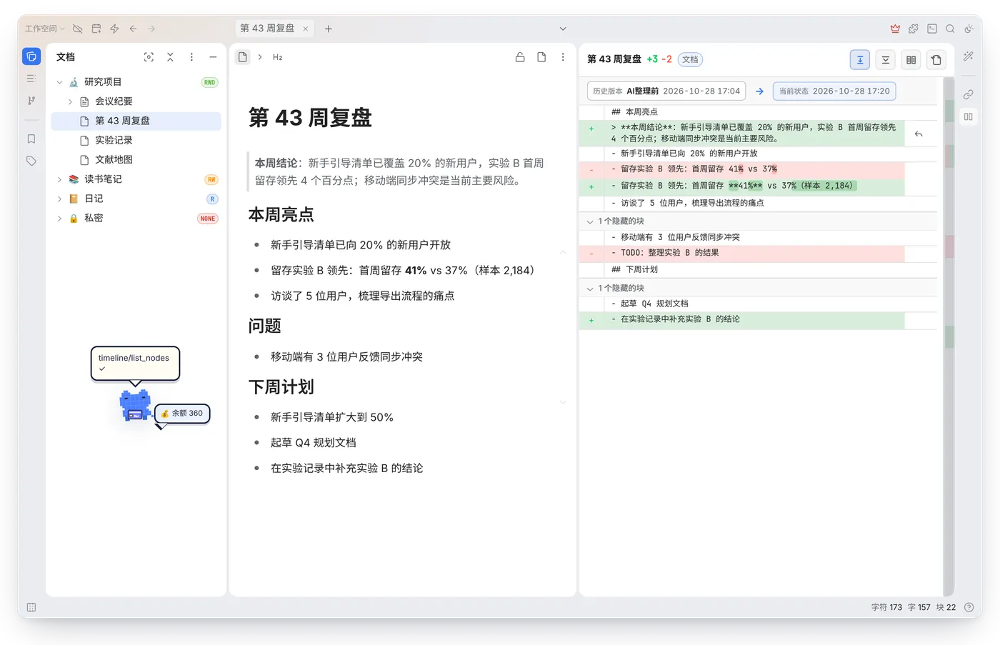
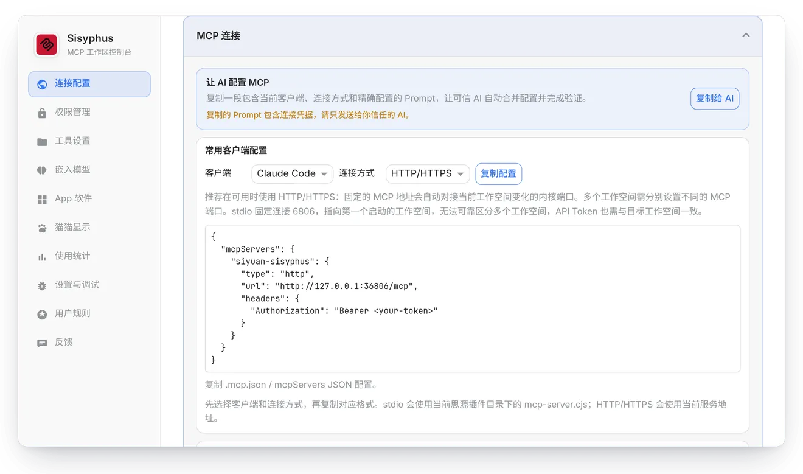
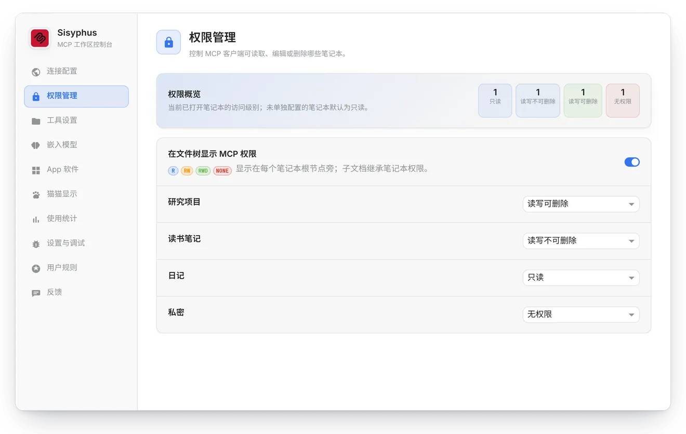
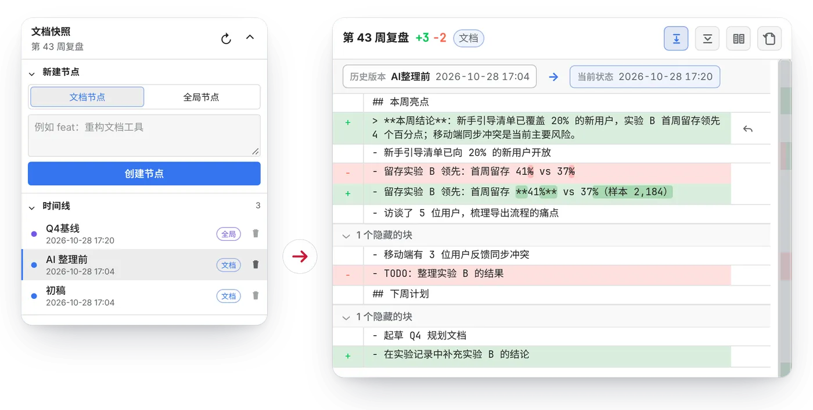
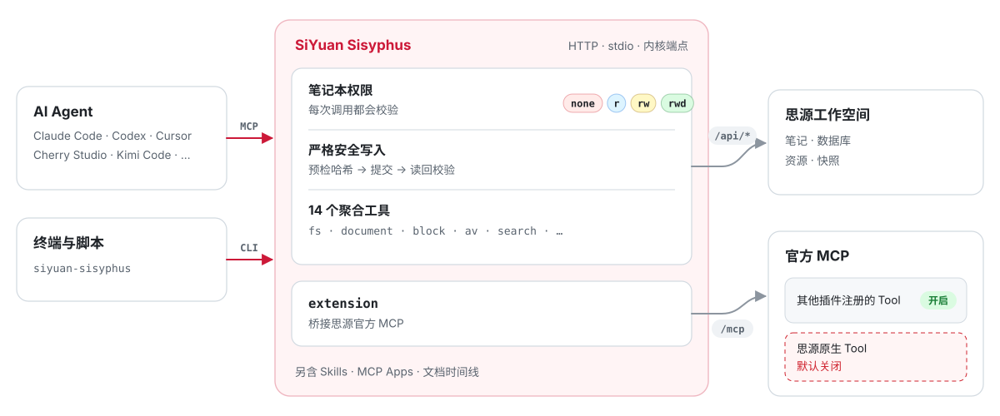

<p align="center">
  
</p>

<h1 align="center">SiYuan Sisyphus</h1>

<p align="center">
  <strong>让 AI 用好你的思源笔记：只在你允许的范围内操作，每一处改动都能检查和回退。</strong>
</p>

<p align="center">
  思源笔记的 MCP 服务与 CLI：14 个聚合工具、笔记本级权限、<br>
  严格安全写入、类 Git 文档时间线与 MCP Apps 交互界面。
</p>

<p align="center">
  <a href="https://github.com/yangtaihong59/siyuan-plugins-mcp-sisyphus/releases"></a>
  <a href="https://www.npmjs.com/package/siyuan-sisyphus"></a>
  <a href="https://yangtaihong59.github.io/siyuan-plugins-mcp-sisyphus/zh/"></a>
  <a href="https://github.com/yangtaihong59/siyuan-plugins-mcp-sisyphus/blob/main/LICENSE"></a>
</p>

<p align="center">
  <a href="https://github.com/yangtaihong59/siyuan-plugins-mcp-sisyphus/blob/main/README.md">English</a> ·
  <strong>简体中文</strong> ·
  <a href="https://yangtaihong59.github.io/siyuan-plugins-mcp-sisyphus/zh/">文档</a> ·
  <a href="https://github.com/yangtaihong59/siyuan-plugins-mcp-sisyphus/blob/main/CHANGELOG.md">更新日志</a>
</p>

<p align="center">
  
</p>
<p align="center"><sub>AI 刚整理完一篇周复盘：文件树显示它能操作的范围，文档 Diff 列出它改了什么，猫猫报告最近一次工具调用。</sub></p>

> **最新版本 v0.7.0**：严格写入预检新增写入影响预览；存在不可读笔记本时 `query_sql` 改为按笔记本限定的受限 SQL；读取返回 `ifMatch`，并可选开启“低风险一步写入”（默认关闭）；`document create` 支持批量 `docs`；另修复多轮 AI 体验测试发现的一批问题。CLI 同步提升至 `v0.3.0`。更早的版本见[更新日志](https://github.com/yangtaihong59/siyuan-plugins-mcp-sisyphus/blob/main/CHANGELOG.md)。

## 亮点

- **笔记本级权限**：每个笔记本可设为 `none`、`r`、`rw` 或 `rwd`，删除、移动、替换等高风险动作另有独立开关。
- **严格安全写入**：写入前校验目标的当前状态哈希，只提交一次并读回确认，不做盲目重试。
- **为 AI 改动准备的文档时间线**：AI 动手前先建节点，随时与当前文档对比，可回退整篇文档或单个块。
- **低上下文、广覆盖**：100 多项思源能力收敛为 14 个按 action 路由的工具，详细帮助和 Skill 按需加载。
- **人类可读路径**：`fs` 支持 `/笔记本/项目/文档` 这样的路径，AI 不必理解块 ID 和文档树。
- **MCP Apps**：闪卡复习、文档时间线和猫猫商店直接在对话里打开，最后一步由用户亲手完成。
- **接入官方 MCP 生态**：`extension` 桥接思源官方 `/mcp`，其他插件注册的 Tool 会出现在同一个连接里。
- **MCP 与 CLI 共用核心**：同一个工具无论由 Agent 经 MCP 调用，还是由脚本在终端运行，行为都一致。

## 快速开始

1. 从思源集市安装 **SiYuan Sisyphus**。插件支持思源 2.9.0+；官方 MCP 桥接和内核端点需要思源 3.7.0+。
2. 打开插件设置，进入 **连接配置 → MCP 连接**，选择客户端和连接方式，复制生成的配置。内置 Claude Code、Codex CLI、Cursor、Cherry Studio、Kimi Code、OpenCode、CC Switch 和 DSH 等预设。
3. 先让 AI 执行一个只读请求，例如“列出我的思源笔记本”。

<p align="center">
  
</p>

更习惯终端？CLI 直接运行同一套工具，也不会把工具 Schema 塞进模型上下文：

```bash
npm i -g siyuan-sisyphus
siyuan-sisyphus init                       # 填写思源 API 地址和 Token
siyuan-sisyphus notebook list
siyuan-sisyphus document list-tree --notebook <id> --json
```

本地、远程、Docker、HTTPS 和移动端的配置方式见[快速开始](https://yangtaihong59.github.io/siyuan-plugins-mcp-sisyphus/zh/getting-started/)与[部署文档](https://yangtaihong59.github.io/siyuan-plugins-mcp-sisyphus/zh/getting-started/deployment.html)。

## 由你掌控

### 笔记本权限

| 级别 | 读取 | 写入 | 删除 |
|---|:---:|:---:|:---:|
| `rwd` | ✓ | ✓ | ✓ |
| `rw` | ✓ | ✓ | |
| `r` | ✓ | | |
| `none` | | | |

文档继承所在笔记本的权限。未配置的笔记本默认只读，安装插件后新建的笔记本默认 `rwd`。文件树中每个笔记本旁的徽标显示当前权限，点击即可循环切换。

<p align="center">
  
</p>

### 严格安全写入

严格安全写入默认开启（**设置与调试 → 严格安全写入**）。

- 修改型 action 先以 `validateOnly=true` 获取目标的当前状态哈希，再携带服务端签发的 `requestId` 和对应的 `expected*Hash` 提交。
- 写请求只发送一次。超时或断线时返回 `outcome_unknown`，不会冒险重复写入；已提交的 `requestId` 会从账本重放结果。
- 严格模式不创建思源数据快照。同步、导出、通知、第三方 Tool 等无法读回的外部副作用会明确标记为“不提供严格保证”。
- CLI 与 stdio 的严格写入统一转交给一个协调器：插件内置的 HTTP 服务，或启用后的内核端点（适用于 Docker 和浏览器场景）。

删除、移动、替换、上传资源等危险动作需要明确确认。支持 MCP elicitation 的客户端会先用表单确认，确认之前不会下发；其他客户端沿用 `confirm=true` 约定。详见[严格安全写入](https://yangtaihong59.github.io/siyuan-plugins-mcp-sisyphus/zh/reference/write-safety.html)和[权限模型](https://yangtaihong59.github.io/siyuan-plugins-mcp-sisyphus/zh/reference/permissions.html)。

## 用文档时间线检查和回退

<p align="center">
  
</p>

- AI 动手前先创建**文档节点**，或创建所有文档都能看到的**全局节点**。
- 选择节点即打开**文档 Diff**：支持统一与并排视图、词级高亮、折叠未变化块和变更缩略导航。
- 可以回退整篇文档，也可以只恢复单个块。
- 删除节点只移除用于保护的 tag，底层思源快照仍然保留。

AI 也可以通过 [`timeline` 工具](https://yangtaihong59.github.io/siyuan-plugins-mcp-sisyphus/zh/reference/tools/timeline.html)使用同一工作流；删除节点和回退属于高危操作，默认不向 AI 开放。时间线基于思源的工作空间快照，是一层安全网，而不是完整的 Git 替代品。

## 对话里的 MCP Apps

能够协商 `io.modelcontextprotocol/ui` 的客户端会获得三个启动 Tool，每个打开一个内联 App。

<p align="center">
  
</p>

| App | 启动 Tool | 在 App 中可以做什么 |
|---|---|---|
| [闪卡复习](https://yangtaihong59.github.io/siyuan-plugins-mcp-sisyphus/zh/reference/tools/flashcard.html) | `flashcard_review_session` | Agent 选出 1–20 张到期卡片；你逐张显示答案，并评为重来、困难、良好或简单。 |
| [文档时间线](https://yangtaihong59.github.io/siyuan-plugins-mcp-sisyphus/zh/reference/tools/timeline.html) | `timeline_app` | 浏览和创建节点，查看块级 Diff，回退整篇文档或单个块。 |
| [猫猫商店](https://yangtaihong59.github.io/siyuan-plugins-mcp-sisyphus/zh/reference/tools/mascot.html) | `mascot_shop_app` | 花掉猫猫靠工具调用攒下的金币；从取货口取走商品时，桌面猫猫会收到它。 |

- 只有启动 Tool 会打开 App；普通的 `flashcard`、`timeline`、`mascot` 调用仍是数据工具。
- Agent 负责准备，你负责决定：模型不会代替你回答闪卡、选择评分、回退笔记或购买商品。
- App action 通过 `visibility: ["app"]` 对模型隐藏，可在 **设置 → App 软件** 中逐项启用。
- 未声明 MCP Apps 支持的客户端看不到这些内容，聚合工具和 CLI 的行为保持不变。

## 接入思源官方 MCP

在思源 3.7.0+ 中，`extension` 会读取官方 `/mcp` 注册表，把允许暴露的 Tool 转换为 action。下游参数全部放在 `arguments` 中，即使下游 Tool 也有 `action` 字段，也不会与 Sisyphus 的路由冲突：

```json
{ "action": "plugin__example__search", "arguments": { "action": "query", "keyword": "MCP" } }
```

| 工具来源 | 默认 | 安全边界 |
|---|---|---|
| Sisyphus 聚合工具 | 开启 | 笔记本权限、action 开关与严格安全写入 |
| 其他插件注册的 Tool | 开启 | 由 `extension` 发现，遵循各自的权限语义 |
| 思源原生 MCP Tool | 关闭 | 使用管理员会话或 API Token 执行 |

发现过程带版本检测且惰性执行：低于思源 3.7.0 时不会请求 `/mcp`；`/mcp` 不可用时只隐藏动态 action。工具设置页会列出每个已发现 Tool 的来源、Schema 体积和风险，并可逐个关闭。插件开发者只需把 Tool 注册到思源官方 MCP，Sisyphus 就能直接发现，无需单独适配。详见 [`extension` 工具文档](https://yangtaihong59.github.io/siyuan-plugins-mcp-sisyphus/zh/reference/tools/extension.html)。

> **安全提示：** 其他插件的 Tool 与思源原生 Tool 不经过 Sisyphus 的笔记本权限和危险操作控制。原生 Tool 只应在本机或完全可信的客户端中启用。

## 工作原理

<p align="center">
  <picture>
    <source media="(prefers-color-scheme: dark)" srcset="./assets/readme/architecture_zh_CN-dark.svg">
    
  </picture>
</p>

Sisyphus 自有的能力，包括 `fs`、文档工具、时间线、权限管理和 CLI，都只通过 `/api/*` 访问思源，因此在桌面、Docker 和远程场景下表现一致；`/mcp` 只由 `extension` 使用。

- **MCP**（HTTP、stdio 或内核端点）适合需要自动发现工具、组合多步操作的 Agent。
- **CLI** 适合脚本和单次任务。

服务端支持 MCP 2026-07-28（无会话 HTTP、逐请求元数据），同时为 2025 代客户端保留基于会话的兼容；详见[协议兼容说明](https://yangtaihong59.github.io/siyuan-plugins-mcp-sisyphus/zh/getting-started/#mcp-2026-07-28-与旧客户端)。

## 面向 Agent 的场景 Skill

内置浏览、编辑、搜索、数据库、导出、标签、闪卡、时间线、系统安全和思源排版等场景指南。MCP 客户端先读取 `siyuan://skills/index`，再按需加载 `siyuan://skills/{name}`；同一套指南也通过草案 SEP-2640 Skills over MCP 扩展发布。支持安装 `SKILL.md` 的 Agent 可以把它们复制到本地：

```bash
siyuan-sisyphus skill install --bundle mcp   # MCP 调用约定
siyuan-sisyphus skill install --bundle all   # 同时安装 MCP 与 CLI 两套
```

仓库还提供 Codex Agent Plugin 包装：[`agent-plugin/siyuan-sisyphus`](https://github.com/yangtaihong59/siyuan-plugins-mcp-sisyphus/tree/main/agent-plugin/siyuan-sisyphus)。更多说明见[场景 Skill 与 MCP Prompt](https://yangtaihong59.github.io/siyuan-plugins-mcp-sisyphus/zh/getting-started/#场景-skill-与-mcp-prompt)。

## 项目方向

SiYuan Sisyphus 最初诞生于一个朴素的愿望：让思源笔记能够连接外部 AI Agent，补强当时思源在 AI 工具接入方面的能力。

如今，思源已经推出官方 MCP，Sisyphus 在连接思源与外部 AI Agent 方面的阶段性使命也已告一段落。在官方 MCP 生态仍处于起步阶段的当下，Sisyphus 的重心将逐步转向：持续打磨 AI 与思源之间的连接体验，探索更加自然、高效、可靠的 AI 辅助工作流。

目前，Sisyphus 在延续原有能力与工作流的同时，已经接入思源官方 MCP 生态，能够调用和管理其他插件注册的 Tool，让不同插件提供的能力可以被 AI 统一发现、灵活组合并协同使用。

接下来会重点改善：常见 Agent 的连接配置与兼容性；HTTP、stdio、本地、远程和 Docker 场景；官方 MCP Tool 的发现、同步、筛选与 Schema 体积；更清晰的调用状态、错误信息和断线恢复；以及更贴近真实任务的 Skill、帮助与实测验证。

## 欢迎反馈

欢迎提交 bug、使用体验和修改建议：

- [GitHub Issues](https://github.com/yangtaihong59/siyuan-plugins-mcp-sisyphus/issues)：公开讨论问题、需求和设计建议；
- 内置 `feedback` 工具：Agent 可以直接调用 `feedback(action="submit", description="...")` 提交反馈。

反馈时请不要包含 API Token、密钥、私密笔记内容或敏感本地路径。

## 文档

[快速开始](https://yangtaihong59.github.io/siyuan-plugins-mcp-sisyphus/zh/getting-started/) ·
[常见任务](https://yangtaihong59.github.io/siyuan-plugins-mcp-sisyphus/zh/reference/common-tasks.html) ·
[工具参考](https://yangtaihong59.github.io/siyuan-plugins-mcp-sisyphus/zh/reference/) ·
[权限模型](https://yangtaihong59.github.io/siyuan-plugins-mcp-sisyphus/zh/reference/permissions.html) ·
[严格安全写入](https://yangtaihong59.github.io/siyuan-plugins-mcp-sisyphus/zh/reference/write-safety.html) ·
[开发文档](https://yangtaihong59.github.io/siyuan-plugins-mcp-sisyphus/zh/development/)

## ❤️ 项目贡献者

<a href="https://github.com/yangtaihong59/siyuan-plugins-mcp-sisyphus/graphs/contributors">
  
</a>

Made with [contrib.rocks](https://contrib.rocks/).

## 赞赏支持

如果你觉得这个项目对你有帮助，欢迎赞赏支持！
给孩子买点 token 吧！

感谢 **undefined**、**Fngd Z**、**ou**、**米建**、**锋🌀☁️**、**wooh**、**芝士柴犬**和其他好心人对本项目的赞助支持。

<p align="left">
  
</p>

## 许可证

[MIT](https://github.com/yangtaihong59/siyuan-plugins-mcp-sisyphus/blob/main/LICENSE)
